# Customer Shopping Behaviour Dashboard (Power BI)

A 4-page Power BI dashboard that analyses **3,900 customer purchases**. It covers revenue, customers, subscriptions, discounts and shipping. The data comes from a SQL Server table (`customer_data`).

---

## Table of Contents
1. [Project Overview](#1-project-overview)
2. [Business Questions](#2-business-questions)
3. [Tools & Tech Stack](#3-tools--tech-stack)
4. [Data Source](#4-data-source)
5. [Dataset Description](#5-dataset-description)
6. [Data Model](#6-data-model)
7. [DAX Measures](#7-dax-measures)
8. [Dashboard Pages](#8-dashboard-pages)
9. [Key Insights & Charts](#9-key-insights--charts)
10. [Recommendations](#10-recommendations)
11. [Data Limitations](#11-data-limitations)
12. [Fixes & Improvements Made](#12-fixes--improvements-made)
13. [How to Run](#13-how-to-run)
14. [Project Structure](#14-project-structure)
15. [Interview Summary](#15-interview-summary)

---

## 1. Project Overview

| Item | Detail |
|---|---|
| **Goal** | Understand customer purchasing behaviour and show the key business KPIs in one interactive report |
| **Data** | 1 table, 3,900 rows, 18 columns |
| **Output** | 4-page Power BI report with 24 KPI cards, 11 bar/column charts, 2 donut charts, 3 tables and 4 synced slicers |
| **Total Revenue** | 233,081 |
| **Avg Order Value** | 59.76 |

### 📊 Headline KPIs

| 💰 Total Revenue | 🛒 Total Orders | 👥 Customers | 🧾 Avg Order Value | ⭐ Avg Rating | 🔁 Subscription Rate | 🏷️ Discount Usage |
|:---:|:---:|:---:|:---:|:---:|:---:|:---:|
| **233,081** | **3,900** | **3,900** | **59.76** | **3.75 / 5** | **27.0%** | **43.0%** |

---

## 2. Business Questions

1. How much revenue do we make, and from which **categories and products**?
2. Who are our customers by **age group, gender and purchase frequency**?
3. How many customers **subscribe**, and do subscribers spend more?
4. How often are **discounts** used, and do they change order value?
5. Which **payment methods and shipping types** do customers prefer?

---

## 3. Tools & Tech Stack

| Tool | Used for |
|---|---|
| **SQL Server** | Storing the cleaned data (`Customer_Behaviour` database) |
| **Power Query (M)** | Loading the table into Power BI |
| **Power BI Desktop** | Data model, DAX measures and report design |
| **DAX** | 21 business measures |
| **Custom JSON theme** | Consistent colours, fonts and visual styling |

---

## 4. Data Source

The data is loaded from a local SQL Server database:

```m
let
  Source = Sql.Database("PRINCE", "Customer_Behaviour"),
  #"Navigation 1" = Source{[Schema = "dbo", Item = "customer_data"]}[Data]
in
  #"Navigation 1"
```

| Setting | Value |
|---|---|
| Server | `PRINCE` *(local machine name, so change it to your own server)* |
| Database | `Customer_Behaviour` |
| Table | `dbo.customer_data` |
| Mode | Import |

---

## 5. Dataset Description

**Table:** `customer_data`. It has **3,900 rows** (one row per customer purchase) and **no missing values**.

| # | Column | Type | Description | Values / Range |
|---|---|---|---|---|
| 1 | `customer_id` | Integer | Unique customer ID | 3,900 unique |
| 2 | `age` | Integer | Customer age | 18 – 70 |
| 3 | `gender` | Text | Customer gender | Male, Female |
| 4 | `item_purchased` | Text | Product bought | 25 items (Blouse, Shirt, Jeans…) |
| 5 | `category` | Text | Product category | Clothing, Accessories, Footwear, Outerwear |
| 6 | `purchase_amount` | Integer | Purchase value | 20 – 100 |
| 7 | `location` | Text | US state | 50 states |
| 8 | `color` | Text | Product colour | 25 colours |
| 9 | `season` | Text | Season of purchase | Fall, Winter, Spring, Summer |
| 10 | `review_rating` | Decimal | Customer rating | 2.5 – 5.0 |
| 11 | `subscription_status` | Text | Is the customer subscribed? | Yes, No |
| 12 | `shipping_type` | Text | Delivery method | 6 types (Standard, Express, Free Shipping…) |
| 13 | `discount_applied` | Text | Was a discount used? | Yes, No |
| 14 | `previous_purchases` | Integer | Past purchases by the customer | 1 – 50 |
| 15 | `payment_method` | Text | How the customer paid | 6 methods (Credit Card, PayPal, Cash…) |
| 16 | `frequency_of_purchases` | Text | How often they buy | Weekly → Annually (7 values) |
| 17 | `age_group` | Text | Derived age band | Young Adult (18–31), Adult (32–44), Middle-aged (45–57), Senior (58–70) |
| 18 | `purchase_frequency_days` | Integer | Frequency converted to days | 7, 14, 30, 90, 365 |

> `age_group` and `purchase_frequency_days` are **engineered columns** created during data cleaning.

---

## 6. Data Model

- **Single-table model** with one fact table (`customer_data`) and no relationships needed.
- All measures are stored **in the data model** on the `customer_data` table.
- **There are no duplicate or report-level measures.** Each KPI is defined exactly once.

```
customer_data (3,900 rows)
 ├── 18 columns
 └── 21 DAX measures
```

---

## 7. DAX Measures

### 7.1 Core KPIs
| Measure | DAX | Format |
|---|---|---|
| Total Revenue | `SUM(customer_data[purchase_amount])` | #,0 |
| Total Orders | `COUNTROWS(customer_data)` | #,0 |
| Total Customers | `DISTINCTCOUNT(customer_data[customer_id])` | #,0 |
| Avg Order Value | `DIVIDE([Total Revenue], [Total Orders])` | #,0.00 |
| Avg Review Rating | `AVERAGE(customer_data[review_rating])` | 0.00 |
| Avg Previous Purchases | `AVERAGE(customer_data[previous_purchases])` | 0.0 |

### 7.2 Share-of-Total Measures
| Measure | DAX | Format |
|---|---|---|
| Revenue % of Total | `DIVIDE([Total Revenue], CALCULATE([Total Revenue], ALLSELECTED(customer_data)))` | 0.0% |
| Revenue % within Category | `DIVIDE([Total Revenue], CALCULATE([Total Revenue], ALLEXCEPT(customer_data, customer_data[category])))` | 0.0% |
| Orders % of Total | `DIVIDE([Total Orders], CALCULATE([Total Orders], ALLSELECTED(customer_data)))` | 0.0% |

### 7.3 Subscription Measures
| Measure | DAX | Format |
|---|---|---|
| Subscribers | `CALCULATE([Total Customers], customer_data[subscription_status] = "Yes")` | #,0 |
| Subscription Rate % | `DIVIDE([Subscribers], [Total Customers])` | 0.0% |
| Subscriber Revenue | `CALCULATE([Total Revenue], customer_data[subscription_status] = "Yes")` | #,0 |
| Non-Subscriber Revenue | `CALCULATE([Total Revenue], customer_data[subscription_status] = "No")` | #,0 |
| Subscriber AOV | `CALCULATE([Avg Order Value], customer_data[subscription_status] = "Yes")` | #,0.00 |
| Non-Subscriber AOV | `CALCULATE([Avg Order Value], customer_data[subscription_status] = "No")` | #,0.00 |
| Subscriber Revenue Share % | `DIVIDE([Subscriber Revenue], [Total Revenue])` | 0.0% |

### 7.4 Discount Measures
| Measure | DAX | Format |
|---|---|---|
| Discounted Orders | `CALCULATE([Total Orders], customer_data[discount_applied] = "Yes")` | #,0 |
| Discount Usage % | `DIVIDE([Discounted Orders], [Total Orders])` | 0.0% |
| Discounted Revenue | `CALCULATE([Total Revenue], customer_data[discount_applied] = "Yes")` | #,0 |
| AOV With Discount | `CALCULATE([Avg Order Value], customer_data[discount_applied] = "Yes")` | #,0.00 |
| AOV Without Discount | `CALCULATE([Avg Order Value], customer_data[discount_applied] = "No")` | #,0.00 |

**Design choices**
- `DIVIDE()` is used instead of `/` so a zero denominator returns blank instead of an error.
- Measures are **built on other measures** (for example, AOV reuses Total Revenue and Total Orders), so each piece of logic lives in one place.

---

## 8. Dashboard Pages

Every page has the same layout:
- a **page title**
- **4 synced dropdown slicers**: Season, Category, Gender, Age Group
- **6 KPI cards**
- **4 analysis visuals** (bar/column charts, a donut or a table)

### Page 1: Executive Overview
| Visual | Shows |
|---|---|
| KPI cards | Total Revenue, Total Orders, Avg Order Value, Avg Review Rating, Subscription Rate %, Discount Usage % |
| Bar chart | Revenue by Category |
| Column chart | Revenue by Season |
| Bar chart | Revenue by Location (50 states) |
| Donut chart | Revenue by Gender |

### Page 2: Sales & Revenue
| Visual | Shows |
|---|---|
| KPI cards | Total Revenue, Avg Order Value, Discounted Revenue, Subscriber Revenue, Non-Subscriber Revenue, Subscriber Revenue Share % |
| Bar chart | Revenue by Item Purchased |
| Bar chart | Revenue by Payment Method |
| Column chart | Revenue by Age Group |
| Table | Product / Category Detail (Revenue, Orders, AOV) |

### Page 3: Customers & Subscriptions
| Visual | Shows |
|---|---|
| KPI cards | Total Customers, Subscribers, Subscription Rate %, Subscriber AOV, Non-Subscriber AOV, Avg Previous Purchases |
| Column chart | Customers by Age Group |
| Donut chart | Customers by Subscription Status |
| Bar chart | Customers by Purchase Frequency |
| Table | Customer Segment Summary (Age Group × Gender) |

### Page 4: Discounts & Shipping
| Visual | Shows |
|---|---|
| KPI cards | Discounted Orders, Discount Usage %, Discounted Revenue, AOV With Discount, AOV Without Discount, Avg Review Rating |
| Bar chart | Discount Usage % by Category |
| Column chart | Discount Usage % by Season |
| Bar chart | Orders by Shipping Type |
| Table | Payment Method Detail (Orders, Revenue, AOV, Discount %) |

---

## 9. Key Insights & Charts

All figures are for the full dataset with no filters applied. The charts below are drawn by GitHub directly from the README text (Mermaid), so no image files are needed. Each label shows the exact value.

### Headline KPIs
| KPI | Value |
|---|---|
| Total Revenue | **233,081** |
| Total Orders / Customers | **3,900** |
| Avg Order Value | **59.76** |
| Avg Review Rating | **3.75 / 5** |
| Subscribers | **1,053 (27.0%)** |
| Discounted Orders | **1,677 (43.0%)** |

### Revenue
- **Clothing leads.** It brings in 104,264 (**44.7%** of revenue). Accessories follow at 31.8%. Outerwear is smallest at **7.9%**.
- **Top items:** Blouse (10,410), Shirt (10,332) and Dress (10,320). **Lowest:** Jeans (7,548).
- **Seasons are balanced.** Fall is highest (60,018) and Summer is lowest (55,777), a gap of only about 8%.
- **Top states:** Montana (5,784), Illinois (5,617) and California (5,605).

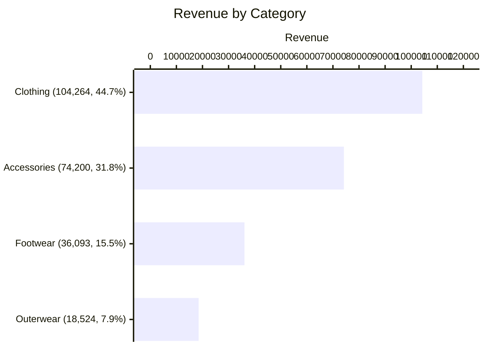

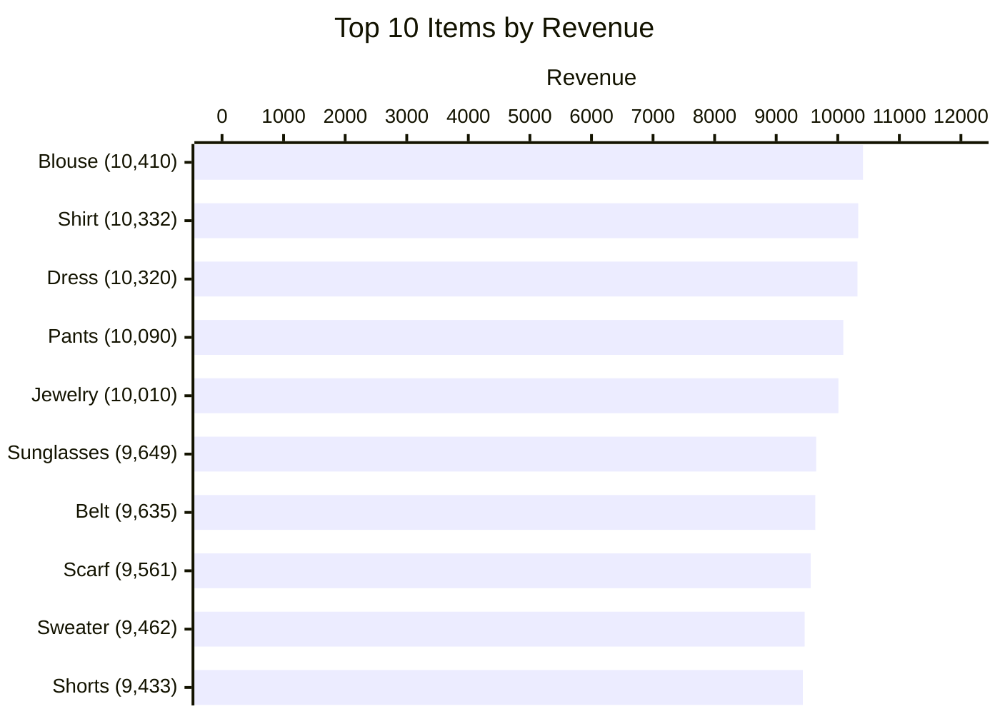

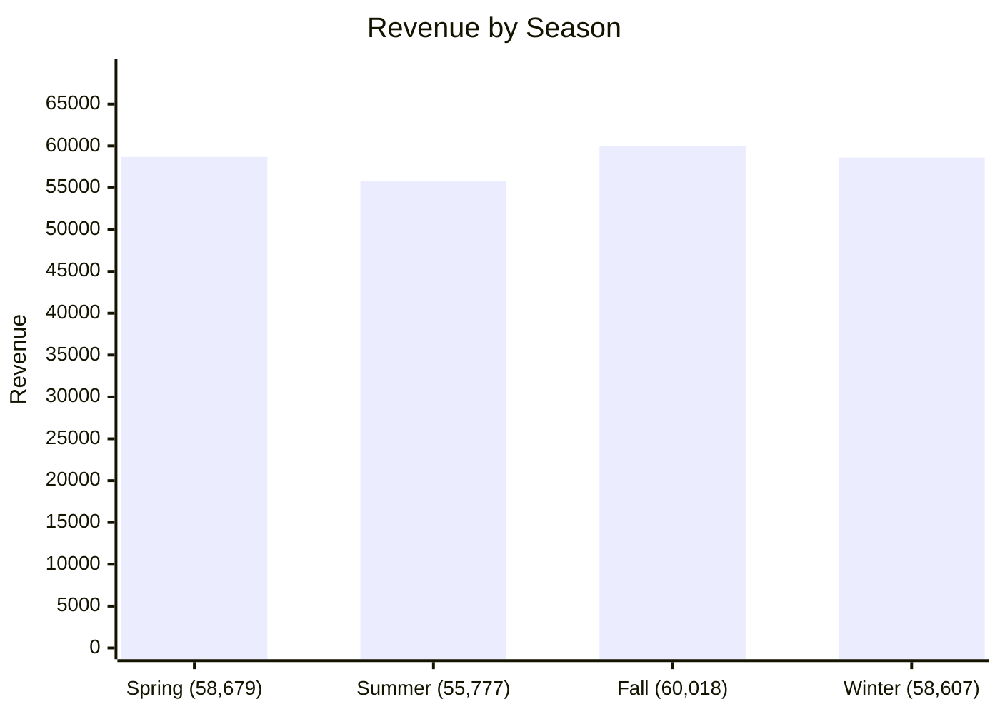

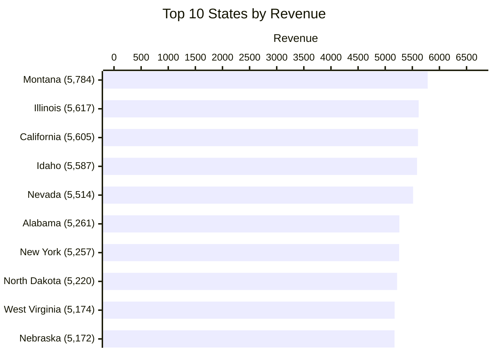

### Customers
- **Male customers bring in 67.7% of revenue** (157,890 from 2,652 customers).
- **Age groups are evenly spread.** Young Adults are the largest group (1,028 customers, 62,143 revenue).
- **Purchase frequency is evenly spread** across all 7 groups (539–584 customers each).

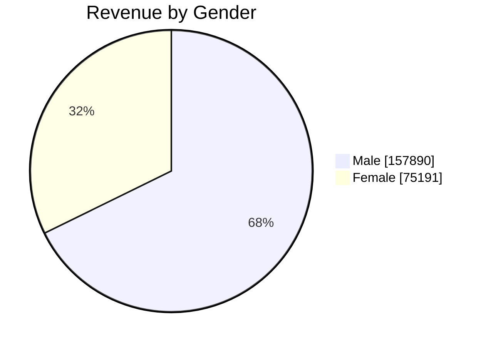

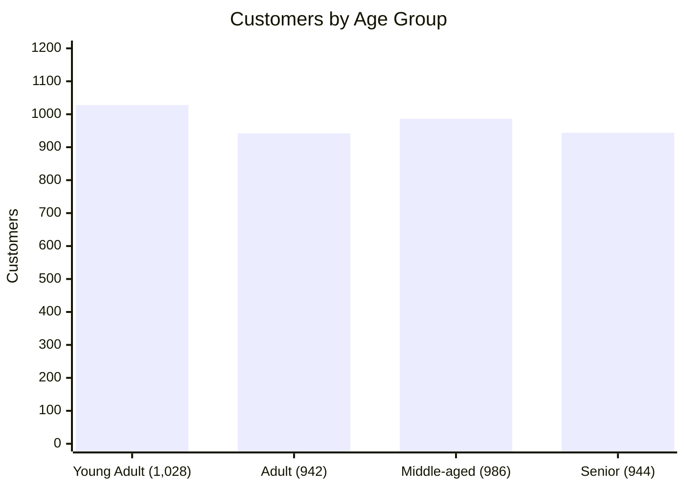

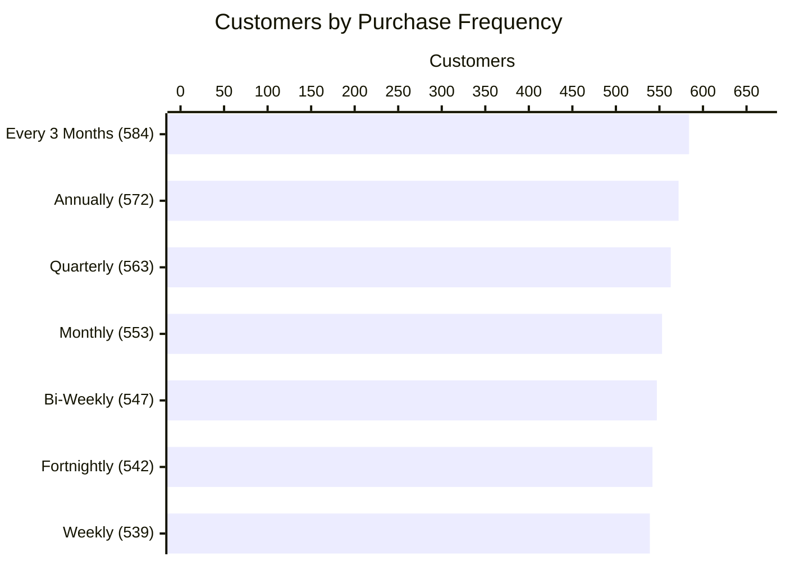

### Subscriptions
- **27.0%** of customers subscribe, and they bring in **26.9%** of revenue (62,645).
- **Subscribers do not spend more per order.** Their AOV is **59.49**, compared with **59.87** for non-subscribers.

### Discounts
- **43.0%** of orders use a discount.
- **Discounts do not raise order value.** AOV with a discount is **59.28**, slightly lower than **60.13** without one.
- Discount usage is similar in every category (42–44%) and season (41–44%).

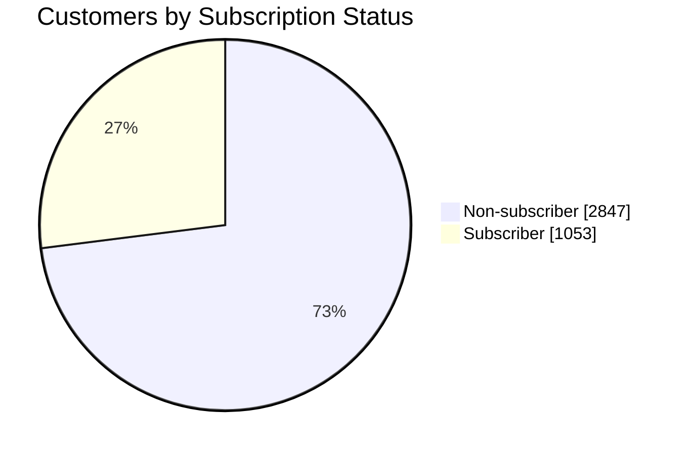

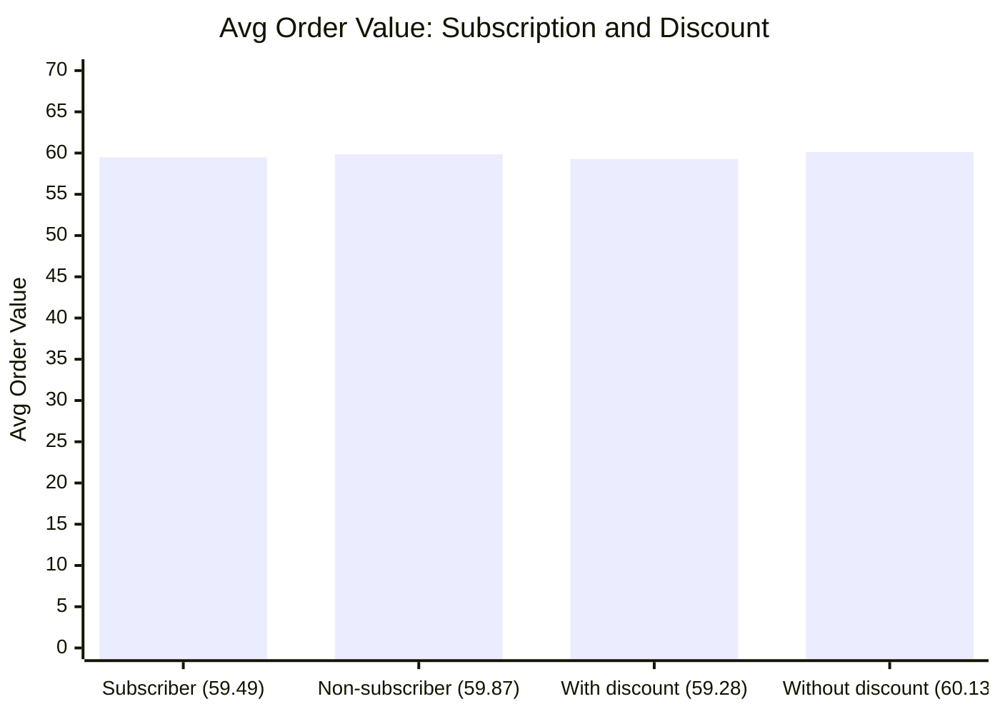

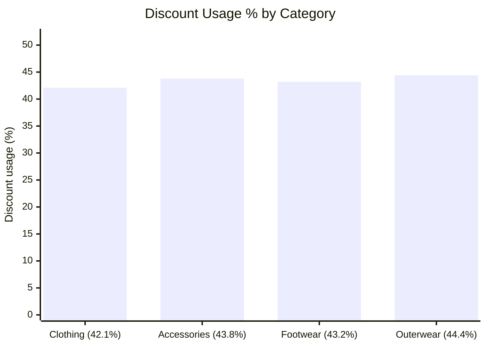

### Payment & Shipping
- All **6 payment methods** and **6 shipping types** are used about equally (about 15–17% each).
- Ratings barely change by shipping type (3.71–3.82).

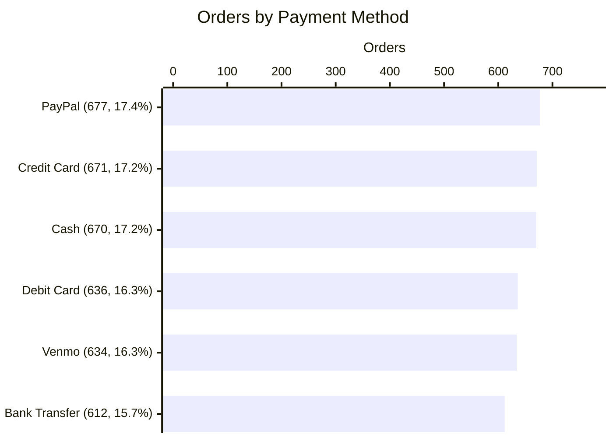

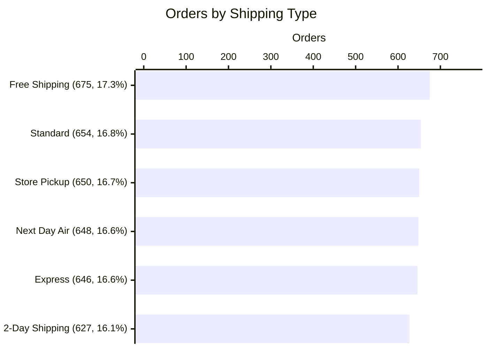

---

## 10. Recommendations

| Finding | Why it matters | Recommendation |
|---|---|---|
| Subscribers spend the same per order | The subscription is not driving bigger baskets | Add subscriber-only bundles or free-shipping thresholds to raise order value |
| Discounts don't increase AOV | Discounts may be reducing margin without lifting spend | Test fewer, more targeted discounts (for example, minimum-spend offers) |
| Clothing = 45% of revenue, Outerwear = 8% | Revenue depends heavily on one category | Cross-sell outerwear and footwear with clothing purchases |
| No female subscribers or discount users | A large segment isn't engaging with these programmes | Check whether this reflects the data or a real gap, then run targeted campaigns |
| Ratings average 3.75 | There is room to improve satisfaction | Collect review comments to find the drivers of low ratings |

> These recommendations are based on patterns in this dataset. They should be tested before acting on them.

---

## 11. Data Limitations

- **No profit or cost data.** Profit and margin KPIs cannot be calculated.
- **No order or delivery dates.** Time trends, delivery delays and on-time rates cannot be measured. *Season* is the only time field.
- **No quantity column.** Units sold cannot be measured; each row is one purchase.
- **One row per customer.** Total Orders = Total Customers = 3,900, so repeat-purchase behaviour is only available through `previous_purchases`.
- **Subscriptions and discounts are 100% male in the data.** All 1,053 subscribers and all 1,677 discounted orders are male, so gender comparisons for these KPIs are not meaningful.

---

## 12. Fixes & Improvements Made

The original report had several issues. They were fixed as follows:

| Problem | Fix |
|---|---|
| **Duplicate measures:** 7 report-level measures had the same names as model measures, so visuals failed to load | Removed all 23 report-level measures; every visual now uses the 21 model measures |
| **Fake KPIs:** 9 measures returned `BLANK()` (Profit, Delay Rate, On-Time Rate, Processing Days…) | Removed, because the data has no profit or date columns |
| **Copied or estimated KPIs:** Total Sales = Total Revenue, Units Sold = row count, Items per Order = 1 | Removed |
| **Wrong titles:** for example, "On-Time Rate" was showing Subscription Rate | Every title now matches its measure |
| **Wrong slicers:** two slicers on `location`, "Order Date" was actually Season | 4 distinct slicers: Season, Category, Gender, Age Group |
| **% measures showed as decimals** (0.27) | Set measure formats: `0.0%`, `#,0`, `#,0.00` |
| **Cards cut off and shortened** (233K, 4K) | Classic cards with display units set to *None* (233,081) |
| **Plain design** | Custom theme, page headers, data labels, cleaner axes |
| **Misleading chart:** Subscription Rate by Gender showed only Male | Replaced with Customers by Subscription Status |

---

## 13. How to Run

1. **Install** Power BI Desktop (free from Microsoft).
2. **Restore the data** to SQL Server:
   - database `Customer_Behaviour`
   - table `dbo.customer_data`
3. **Open** `Customer_Dashboard_FIXED_v2.pbix`.
4. **Update the server name:**
   - Go to **Transform data → Data source settings → Change Source**.
   - Replace `PRINCE` with your own SQL Server name.
5. Click **Refresh**.

> The `.pbix` already contains imported data, so you can view the report without SQL Server. You only need SQL Server to refresh the data.

---

## 14. Project Structure

```
Customer-Shopping-Behaviour-Dashboard/
├── Customer_Dashboard_FIXED_v2.pbix   # Power BI report (final version)
├── README.md                          # Project documentation (this file)
└── screenshots/                       # Add page screenshots here
    ├── 1_executive_overview.png
    ├── 2_sales_revenue.png
    ├── 3_customers_subscriptions.png
    └── 4_discounts_shipping.png
```

> **Tip:** Add Power BI page screenshots to this README with
> ``

---

*Built with Power BI Desktop · Data: `customer_data` (3,900 rows)*
